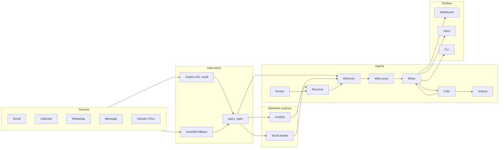

# Recall

Voice-first meeting prep: say who you are about to meet, and Recall assembles a sourced brief from personal channels, calendar, memory, and the web.

## Problem

We are building an agent that helps a busy founder/student prepare for any meeting in under 30 seconds by reconciling everything they know about one person across Gmail, Calendar, iMessage, Messenger/WhatsApp, their own notes and the public web, producing a spoken, sourced brief with next actions.

## Why Track 01 (Fragmented Intelligence)

- One person lives across many handles and apps (three Omars, two Daniel Kims, "Sasha" = Alexandra Petrova).
- Contact cards go stale (Lucas moved to Paris, Priya changed jobs).
- An EA books meetings for someone else (Tyler Brooks for Rachel Goldberg).
- The agent discovers, reconciles and cites the source of every fact.

## Architecture



## Agents

| Agent | Role | Input | Output | Collaborates with |
|---|---|---|---|---|
| Router | Intent + person hint | utterance | `RouterResult` | Resolver |
| Resolver | Clarify / calendar tie-break | candidates, calendar | entity or clarify | Router, Retriever |
| Retriever | Evidence pack | entity + intent | evidence, open loops | World, H-MEM, Web Scout |
| Web Scout | Public web facts | person / org | web snippets (cached offline) | Retriever, Writer |
| Writer | Draft sourced brief | evidence + style | `Brief` | Critic, Retriever |
| Critic | Revise / refetch / pass | draft + evidence | `CriticVerdict` | Writer, Retriever |
| Actions | Confirmable next steps | brief + intent | dry-run / execute | Writer |
| Suggester | Follow-up prompts | brief | suggestions | Writer |

## Collaboration checklist

- **Delegation** — Router → Resolver → Retriever → Writer → Critic → Actions.
- **Critique + revision loop** — Critic may `revise` / `refetch`; Writer revises (max 2 rounds).
- **Shared state** — Meterless World Model + H-MEM under `logs/<run_id>/`.
- **Branching on confidence** — clarify when names collide; unresolved when evidence stays missing.
- **Retry / fallback** — Zetaris → DuckDB; NVIDIA → recorded cache → offline rules.
- **Traceable evidence** — every talking point cites evidence ids; full JSONL trace.

## Judge in 3 minutes

```bash
make demo
```

Then try:

1. `I'm meeting Omar` → three-way clarify ([01](output_examples/01_three_omars/how_it_worked.md)).
2. `Where does Lucas live?` → contact vs messages conflict ([04](output_examples/04_conflicting_sources/how_it_worked.md)).
3. `Sync with Mei tomorrow` → Writer↔Critic revision ([06](output_examples/06_revision_loop/how_it_worked.md) — open this file to see the loop).

Full index: [output_examples/README.md](output_examples/README.md).

## Examples

| Input | Shows | Output |
|---|---|---|
| [01_three_omars](input_examples/01_three_omars.json) | Disambiguation across three Omars | [brief](output_examples/01_three_omars/brief.md) · [how](output_examples/01_three_omars/how_it_worked.md) |
| [02_brief_omar_haddad](input_examples/02_brief_omar_haddad.json) | Sourced brief + Rachel intro loop | [brief](output_examples/02_brief_omar_haddad/brief.md) · [how](output_examples/02_brief_omar_haddad/how_it_worked.md) |
| [03_nickname_identity](input_examples/03_nickname_identity.json) | Sasha → Alexandra Petrova | [brief](output_examples/03_nickname_identity/brief.md) · [how](output_examples/03_nickname_identity/how_it_worked.md) |
| [04_conflicting_sources](input_examples/04_conflicting_sources.json) | Montreal card vs Paris messages | [brief](output_examples/04_conflicting_sources/brief.md) · [how](output_examples/04_conflicting_sources/how_it_worked.md) |
| [05_memory_carryover](input_examples/05_memory_carryover.json) | H-MEM note into a later brief | [brief](output_examples/05_memory_carryover/brief.md) · [how](output_examples/05_memory_carryover/how_it_worked.md) |
| [06_revision_loop](input_examples/06_revision_loop.json) | Writer↔Critic revise then pass | [brief](output_examples/06_revision_loop/brief.md) · [how](output_examples/06_revision_loop/how_it_worked.md) |

Regenerate: `make examples`.

## Evaluation

Headline from [output_examples/eval_report.md](output_examples/eval_report.md): **19/23 (82.6%)**, person accuracy **100%** (18/18).

Method note: the 23 questions were visible during development (not held-out). Code has no dataset-specific literals (`tests/test_no_hardcoding.py`). Failures are left honest.

Rerun: `make eval`.

## Quickstart

```bash
uv sync
cp .env.example .env
uv run python -m recall ingest --sample
uv run python -m recall ask "I'm meeting Omar Haddad on Wednesday" --sample
cd web && npm install && npm run build && cd ..
uv run python -m recall serve
# open http://localhost:8000
```

`SAMPLE_MODE=true` (default in `.env.example`) needs no API keys: synthetic CSVs under `data/synthetic/tables`, cached LLM fixtures, dry-run actions. Unit tests pin `data/sample`.

## CLI

| Command | Purpose |
|---|---|
| `ask "…" [--sample] [--entity-id ID]` | Meeting-prep orchestrator |
| `ingest --sample` / `ingest --live` | Build world DB (+ identity scoring); live pulls connectors → parquet → `data/world.db` |
| `who <name> [--sample]` | Ranked world-model candidates |
| `note "…" [--sample]` | Mine a note into H-MEM |
| `memories <name> [--sample]` | Ranked memories for a resolved person |
| `voice [--check]` | Push-to-talk (right Ctrl / right Option); `--check` validates NVIDIA/Riva keys |
| `serve` | FastAPI + built dashboard on `:8000` |
| `identity …` | List / explain / confirm / reject identity assumptions |
| `llm-test` / `agent-test` | Provider and agent smoke helpers |

## Data

Primary demo is the fictional **Jordan Lefebvre** world in [`data/synthetic/`](data/synthetic/) — see [`data/README.md`](data/README.md). Identity report: **53/53 people sorted perfectly, 0 wrong merges** ([`data/synthetic/identity_report.md`](data/synthetic/identity_report.md)). All committed data is fictional, generated for this hackathon. `data/sample/` is the small unit-test fixture only.

Live connectors write under gitignored `data/live/`. Never commit live exports or secrets.

## Meterless

Meterless **World Model** and **H-MEM** agent engines, implemented in Python against the Meterless reference architectures:

| Service | File |
|---|---|
| `WorldStoreService` | `recall/engines/world/store.py` |
| `IngestPipelineService` | `recall/engines/world/ingest.py` (idempotent + fingerprinted) |
| `ContextBuilderService` | `recall/engines/world/context_builder.py` |
| `MemoryStoreService` / `MemoryRetrievalService` / `MemoryMiningService` / `TrustLedgerService` | `recall/engines/hmem/*` |
| Injected generator | `recall/llm/generator.py` |
| Evidence JSONL | `logs/<run_id>/` |

**Markovian is not used** — Recall needs persistent, inspectable identity and memory across runs (World Model + H-MEM ledgers), not a single-turn Markov policy.

## Zetaris

Sample mode uses the **DuckDB fallback through the same `query_layer`**. Traces may show `fallback zetaris→duckdb reason=circuit_open` — that is **expected** when there is no Zetaris instance (default `SAMPLE_MODE`).

To run against a real cluster:

```bash
# after loading CSVs + USL (docs/zetaris_notes.md)
DATA_BACKEND=zetaris SAMPLE_MODE=true uv run python scripts/zetaris_smoke.py
# writes redacted output_examples/zetaris_smoke.txt
```

Path details: USL namespace `lightning.metastore.recallai.recall`, 2 DQ rules, smoke script. See [docs/zetaris_notes.md](docs/zetaris_notes.md) and [output_examples/zetaris_smoke.txt](output_examples/zetaris_smoke.txt).

1. Load tables: `scripts/zetaris_load_sample.sql` (from `settings.sample_data_dir`)
2. Compile USL + DQ: `uv run python scripts/zetaris_setup_usl.py`
3. Smoke: `uv run python scripts/zetaris_smoke.py`

## NVIDIA

- **Nemotron 3 Ultra / Lightning** per role via `ROLE_MODELS` in `recall/config.py` (main vs fast tiers).
- **Nemotron embeddings** for H-MEM (`nvidia_embed_model`).
- **Parakeet ASR** via Riva NVCF in `recall/voice/stt.py`.
- All chat calls go through `recall/llm/generator.py` only.

### See live Nemotron on synthetic data

Default sample mode uses recorded cache → offline rules (zero keys). To call Nemotron while keeping the synthetic dataset:

```bash
# in .env
SAMPLE_MODE=true
LLM_LIVE=true
NVIDIA_API_KEY=nvapi-…
uv run python -m recall ask "I'm meeting Omar Haddad on Wednesday" --sample
```

Traces under `logs/<run_id>/trace.jsonl` show `provider=nvidia` and the model slug on `llm` events. On timeout or error the generator falls back to the recorded cache, then agents use `offline_rules`.

## Sponsor tech

Matches [metadata.json](metadata.json) and [docs/SPONSOR_TECH.md](docs/SPONSOR_TECH.md):

- **Zetaris** — federated reads + USL `recall` (`recall/data/zetaris_backend.py`, `scripts/zetaris_setup_usl.py`).
- **Meterless** — World Model + H-MEM (`recall/engines/world`, `recall/engines/hmem`).
- **Cursor** — `.cursor/rules`, [docs/cursor-log.md](docs/cursor-log.md).
- **NVIDIA** — Nemotron via generator, embeddings, Parakeet ASR.

## Phone (iPhone + AirPods)

Serve on the Windows PC (bound to `127.0.0.1:8000`), then expose via Tailscale and use Siri or the home-screen web app.

### 1. Token

Set `RECALL_API_TOKEN` in `.env` (a random value is fine; `.env.example` ships a demo token). The dashboard prompts once and stores it in `localStorage`, or set `VITE_RECALL_API_TOKEN` for local Vite. Every `/api/*` call and `/ws/trace?token=` needs this bearer token.

### 2. Build + serve

```bash
cd web && npm install && npm run build && cd ..
uv run python -m recall serve
# listens on 127.0.0.1:8000
```

Install **ffmpeg** on the PC PATH so iOS AAC (`audio/mp4`) uploads convert to 16 kHz WAV for Parakeet.

### 3. Tailscale on Windows

```powershell
# after Tailscale is installed and you're logged in
tailscale serve --bg 8000
```

Open the MagicDNS / Tailscale HTTPS URL from the iPhone (same Tailscale account / ACL). The phone UI appears under 640 px width: one hold-to-talk button, brief cards, collapsible trace.

### 4. Home-screen web app

1. In Safari, open the Tailscale URL.
2. Enter the API token when prompted.
3. Share → **Add to Home Screen** (uses the Recall manifest / apple-mobile-web-app tags).
4. Hold the big button to talk (AirPods work); release to send. Clarification shows large name buttons; you can also answer by holding to talk again (`run_id` continues the session).

### 5. Siri Shortcut (optional)

1. Shortcuts → New → **Get Contents of URL**.
2. Method `POST`, URL `https://<your-tailscale-host>/api/ask` (or `/api/voice` with a Dictate → File for audio).
3. Headers: `Authorization: Bearer <RECALL_API_TOKEN>`, `Content-Type: application/json`.
4. Body JSON: `{"text": "<Dictated text>", "run_id": null}`.
5. Speak the `speech` field from the JSON response (Speak Text action).
6. Add to Siri with a phrase like “Meeting prep”.

## Windows notes

- Zetaris platform images are amd64 Docker — use Docker Desktop or WSL2.
- `tzdata` is a declared dependency so zoneinfo works on Windows.
- Voice push-to-talk CLI uses **right Ctrl**; phone/dashboard mic needs a secure context / permissions.
- `tailscale serve` proxies localhost:8000; keep `serve` bound to `127.0.0.1`.

## Data & privacy

- Live connectors write only under gitignored `data/live/`.
- The Mac agent dry-run extract has an explicit **consent gate** before reading local mail/messages.
- No secrets in code, logs, or examples; config via `.env` / `recall/config.py`.

## Limitations + future work

- Sample mode without NVIDIA keys uses recorded cache + offline rules (still multi-agent, no hardcoded briefs).
- Live WhatsApp/iMessage paths are platform-sensitive (local DB / export layouts).
- Live Google Calendar/Gmail writes stay behind confirm; unconfirmed live execute returns a clear refusal.
- Web scout uses cache / dry-run when live search is unavailable.
- Identity / relationship score payloads append under `logs/<run_id>/` as JSONL (not under tracked `data/`).
