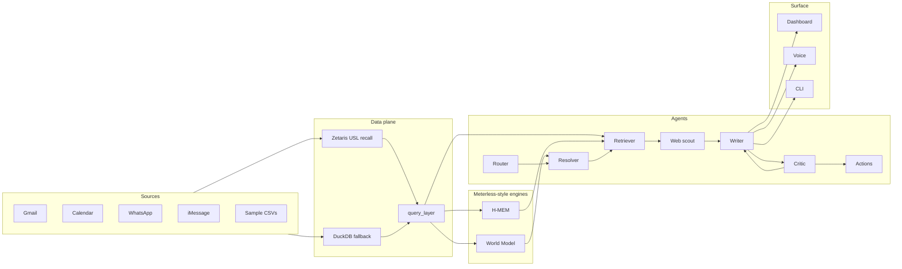

# Recall

Voice-first meeting prep: say who you are about to meet, and Recall assembles a sourced brief from personal channels, calendar, memory, and the web.

## Architecture



## Quickstart

```bash
uv sync
cp .env.example .env
uv run python -m recall ingest --sample
uv run python -m recall ask "I'm meeting Karim" --sample
cd web && npm install && npm run build && cd ..
uv run python -m recall serve
# open http://localhost:8000
```

`SAMPLE_MODE=true` (default in `.env.example`) needs no API keys: sample CSVs, cached LLM fixtures, dry-run actions.

## CLI

| Command | Purpose |
|---|---|
| `ask "…" [--sample] [--entity-id ID]` | Meeting-prep orchestrator |
| `ingest --sample` / `ingest --live` | Build world DB (+ identity scoring); live pulls connectors → parquet → `data/world.db` |
| `who <name> [--sample]` | Ranked world-model candidates |
| `note "…" [--sample]` | Mine a note into H-MEM |
| `memories <name> [--sample]` | Ranked memories for a resolved person |
| `voice [--check]` | Push-to-talk (right Ctrl / right Option); `--check` validates NVIDIA/Riva keys |
| `serve` | FastAPI + built dashboard on `:8000` |
| `identity …` | List / explain / confirm / reject identity assumptions |
| `llm-test` / `agent-test` | Provider and agent smoke helpers |

## Zetaris

Local Docker or AWS Mini cluster (see [docs/zetaris_notes.md](docs/zetaris_notes.md)).

1. Load sample tables: `scripts/zetaris_load_sample.sql`
2. Compile USL + DQ rules: `uv run python scripts/zetaris_setup_usl.py`
3. Smoke (auth, counts, named-query parity): `uv run python scripts/zetaris_smoke.py`

Set `DATA_BACKEND=zetaris` and `ZETARIS_REST_URL` / login or API key in `.env`. With Zetaris down, the query layer falls back to DuckDB.

## Sponsor tech

Matches [metadata.json](metadata.json):

- **Zetaris** — federated reads + Unified Semantic Layer `recall` over file sources and Postgres calendar; 2 DQ rules (`recall/data/zetaris_backend.py`, `scripts/zetaris_setup_usl.py`).
- **Meterless** — World Model (`recall/engines/world`) and H-MEM (`recall/engines/hmem`).
- **Cursor** — `.cursor/rules`, [docs/cursor-log.md](docs/cursor-log.md).
- **NVIDIA** — Nemotron via `recall/llm/generator.py`, NVIDIA embeddings, Parakeet ASR in `recall/voice/stt.py`.

## Data sources

- **Sample mode:** synthetic CSVs only (`data/sample/`). Safe to commit.
- **Live connectors:** Gmail / Calendar / WhatsApp / iMessage write under `data/live/` (gitignored). Never commit live exports or secrets.

## Windows notes

- Zetaris platform images are amd64 Docker — use Docker Desktop or WSL2.
- `tzdata` is a declared dependency so zoneinfo works on Windows.
- Voice push-to-talk uses **right Ctrl**; dashboard mic needs a secure context / permissions.

## Limitations + future work

- Resolver, web scout, and actions confirm/execute are still stubs or partial; orchestrator uses fixture/sample paths where needed.
- `/api/confirm` returns `not_implemented` until actions grow a confirm/execute entrypoint.
- Live WhatsApp/iMessage paths are platform-sensitive (local DB / export layouts).
- Identity scoring writes under `data/identity_scores/` (gitignored runtime output).
