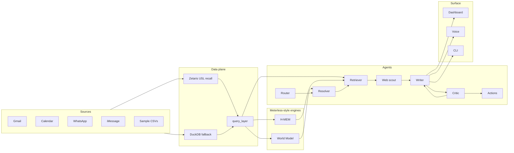

# Recall

Voice-first meeting prep: say who you are about to meet, and Recall assembles a sourced brief from personal channels, calendar, memory, and the web.

## Architecture



## Quickstart

```bash
uv sync
cp .env.example .env
uv run python -m recall ingest --sample
uv run python -m recall ask "I'm meeting Karim" --sample
cd web && npm install && npm run build && cd ..
uv run python -m recall serve
# open http://localhost:8000
```

`SAMPLE_MODE=true` (default in `.env.example`) needs no API keys: sample CSVs, cached LLM fixtures, dry-run actions.

## CLI

| Command | Purpose |
|---|---|
| `ask "…" [--sample] [--entity-id ID]` | Meeting-prep orchestrator |
| `ingest --sample` / `ingest --live` | Build world DB (+ identity scoring); live pulls connectors → parquet → `data/world.db` |
| `who <name> [--sample]` | Ranked world-model candidates |
| `note "…" [--sample]` | Mine a note into H-MEM |
| `memories <name> [--sample]` | Ranked memories for a resolved person |
| `voice [--check]` | Push-to-talk (right Ctrl / right Option); `--check` validates NVIDIA/Riva keys |
| `serve` | FastAPI + built dashboard on `:8000` |
| `identity …` | List / explain / confirm / reject identity assumptions |
| `llm-test` / `agent-test` | Provider and agent smoke helpers |

## Zetaris

Local Docker or AWS Mini cluster (see [docs/zetaris_notes.md](docs/zetaris_notes.md)).

1. Load sample tables: `scripts/zetaris_load_sample.sql`
2. Compile USL + DQ rules: `uv run python scripts/zetaris_setup_usl.py`
3. Smoke (auth, counts, named-query parity): `uv run python scripts/zetaris_smoke.py`

Set `DATA_BACKEND=zetaris` and `ZETARIS_REST_URL` / login or API key in `.env`. With Zetaris down, the query layer falls back to DuckDB.

## Sponsor tech

Matches [metadata.json](metadata.json):

- **Zetaris** — federated reads + Unified Semantic Layer `recall` over file sources and Postgres calendar; 2 DQ rules (`recall/data/zetaris_backend.py`, `scripts/zetaris_setup_usl.py`).
- **Meterless** — World Model (`recall/engines/world`) and H-MEM (`recall/engines/hmem`).
- **Cursor** — `.cursor/rules`, [docs/cursor-log.md](docs/cursor-log.md).
- **NVIDIA** — Nemotron via `recall/llm/generator.py`, NVIDIA embeddings, Parakeet ASR in `recall/voice/stt.py`.

## Data sources

- **Sample mode:** synthetic CSVs only (`data/sample/`). Safe to commit.
- **Live connectors:** Gmail / Calendar / WhatsApp / iMessage write under `data/live/` (gitignored). Never commit live exports or secrets.

## Testing with the synthetic world

[`data/synthetic/`](data/synthetic/) is a larger fictional test world (messy same-name people, changed handles, open loops) in each app’s raw export format, converted through the real connectors into Recall tables, with an answer key for grading.

```bash
uv run python scripts/synthetic/make_synthetic.py      # raw/ + ground_truth/
uv run python scripts/synthetic/raw_to_tables.py       # tables/ + ingest_report.md
SAMPLE_DATA_DIR=data/synthetic/tables uv run python -m recall ask "I'm meeting Omar" --sample
```

Identity merge quality report: [`data/synthetic/identity_report.md`](data/synthetic/identity_report.md).

## Phone (iPhone + AirPods)

Serve on the Windows PC (bound to `127.0.0.1:8000`), then expose via Tailscale and use Siri or the home-screen web app.

### 1. Token

Set `RECALL_API_TOKEN` in `.env` (a random value is fine). The dashboard prompts once and stores it in `localStorage`, or set `VITE_RECALL_API_TOKEN` for local Vite. Every `/api/*` call and `/ws/trace?token=` needs this bearer token.

### 2. Build + serve

```bash
cd web && npm install && npm run build && cd ..
uv run python -m recall serve
# listens on 127.0.0.1:8000
```

Install **ffmpeg** on the PC PATH so iOS AAC (`audio/mp4`) uploads convert to 16 kHz WAV for Parakeet.

### 3. Tailscale on Windows

```powershell
# after Tailscale is installed and you're logged in
tailscale serve --bg 8000
```

Open the MagicDNS / Tailscale HTTPS URL from the iPhone (same Tailscale account / ACL). The phone UI appears under 640 px width: one hold-to-talk button, brief cards, collapsible trace.

### 4. Home-screen web app

1. In Safari, open the Tailscale URL.
2. Enter the API token when prompted.
3. Share → **Add to Home Screen** (uses the Recall manifest / apple-mobile-web-app tags).
4. Hold the big button to talk (AirPods work); release to send. Clarification shows large name buttons; you can also answer by holding to talk again (`run_id` continues the session).

### 5. Siri Shortcut (optional)

1. Shortcuts → New → **Get Contents of URL**.
2. Method `POST`, URL `https://<your-tailscale-host>/api/ask` (or `/api/voice` with a Dictate → File for audio).
3. Headers: `Authorization: Bearer <RECALL_API_TOKEN>`, `Content-Type: application/json`.
4. Body JSON: `{"text": "<Dictated text>", "run_id": null}`.
5. Speak the `speech` field from the JSON response (Speak Text action).
6. Add to Siri with a phrase like “Meeting prep”.

## Windows notes

- Zetaris platform images are amd64 Docker — use Docker Desktop or WSL2.
- `tzdata` is a declared dependency so zoneinfo works on Windows.
- Voice push-to-talk CLI uses **right Ctrl**; phone/dashboard mic needs a secure context / permissions.
- `tailscale serve` proxies localhost:8000; keep `serve` bound to `127.0.0.1`.

## Limitations + future work

- Resolver, web scout, and actions confirm/execute are still stubs or partial; orchestrator uses fixture/sample paths where needed.
- `/api/confirm` returns `not_implemented` until actions grow a confirm/execute entrypoint.
- Live WhatsApp/iMessage paths are platform-sensitive (local DB / export layouts).
- Identity / relationship score payloads append under `logs/<run_id>/` as JSONL.
